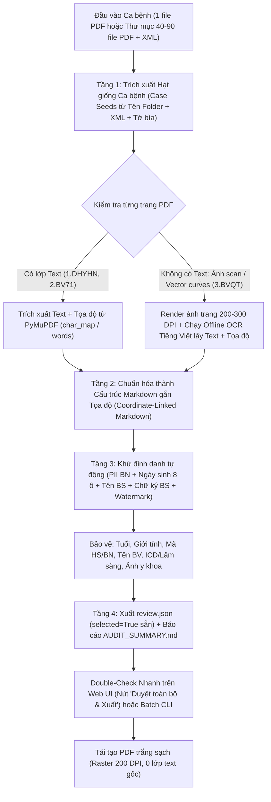

# Thiết Kế Tối Ưu Hóa Công Cụ Khử Định Danh Bệnh Án PDF (HMU De-identification v2.0)

**Ngày:** 2026-10-27  
**Thư mục công cụ:** `D:\Workspaces\HMU_Bo_cong_cu_khu_dinh_danh_PDF\HMU_KhuDinhDanh`  
**Dữ liệu mục tiêu:** `D:\Workspaces\Database (Test-Case1)` (3 bệnh viện: `1.DHYHN`, `2.BV71`, `3.BVQT`)

---

## 1. Mục đích & Bối cảnh (Intent and Why)

Công cụ `HMU_KhuDinhDanh` hiện tại (v1.0/v1.3) được thiết kế để duyệt thủ công từng trang cho 1 file PDF đơn lẻ có lớp text chuẩn. Khi áp dụng vào bộ dữ liệu thực tế gồm 3 bệnh viện với cấu trúc khác nhau:
1. **`1.DHYHN` (Bệnh viện Đại học Y Hà Nội):** Mỗi ca bệnh gồm 40–99 file PDF rời trong một thư mục. Việc nạp từng file qua UI và duyệt từng trang tốn quá nhiều thời gian, đồng thời các file lẻ không tự chia sẻ thông tin định danh (PII) từ Tờ bìa.
2. **`2.BV71` (Thực tế là Bệnh viện Đa khoa Tỉnh Quảng Trị):** Mỗi ca bệnh là 1 file PDF nhiều trang có lớp text, nhưng có 6 watermark chéo/trang (`Hồ Thị Minh Châu_20260803161916`) khiến bộ lọc watermark cũ (chỉ xóa khi có đúng 1 watermark) bị trượt và nhận nhầm tên người in watermark thành tên bệnh nhân. Ngoài ra, ngày sinh trên Tờ bìa bị tách thành 8 ô vuông rời (`1 | 5 | 1 | 0 | 1 | 9 | 5 | 8`) nằm sát cạnh 2 ô Tuổi (`6 | 8`).
3. **`3.BVQT\HH\pdf` (Thực tế là Bệnh viện 71 Trung ương):** Toàn bộ 5 file PDF (46–102 trang/file) được xuất từ ABBYY FineReader / PDF-XChange nhưng **không có lớp text (`fonts = 0`, `get_text() == ""`)**: trang 1–2 là ảnh bitmap nguyên trang, trang 3 trở đi toàn bộ chữ bị biến thành hàng nghìn đường vẽ vector (`drawings`), và phần chữ ký + họ tên bác sĩ được gộp chung vào các ảnh bitmap nhỏ (`275x137`). Công cụ hiện tại hoàn toàn không bắt được chữ nào trên bộ dữ liệu này, buộc người dùng phải khoanh tay 100%.

**Mục tiêu thiết kế:**  
Chuyển đổi quy trình sang **"Trích xuất dữ liệu dạng Markdown/Văn bản gắn tọa độ (kèm OCR cho trang mất text) -> Tự động khử định danh 99% (xóa PII bệnh nhân & bác sĩ + chữ ký, giữ nguyên Tuổi, Giới tính, Mã HS/BN, Tên BV) -> Double-check siêu tốc qua Markdown & Web UI -> Tái tạo PDF trắng sạch giữ nguyên bố cục gốc"**.

---

## 2. Mục tiêu, Phi mục tiêu & Điều cần tránh (Goals, Non-Goals, Anti-Goals)

### 2.1. Mục tiêu (Goals)

#### A. Chính sách Khử định danh (Bắt buộc xóa - Tự động đánh dấu `selected = True`)
1. **Họ và tên người bệnh (`PATIENT_NAME`) & Người nhà (`RELATIVE_NAME`):** Mọi vị trí xuất hiện (có nhãn hoặc lan truyền không nhãn, viết hoa/thường, có dấu/không dấu).
2. **Số điện thoại (`PHONE_NUMBER_VN`, `CONTACT_PHONE`):** SĐT người bệnh, SĐT người nhà, SĐT liên hệ.
3. **Địa chỉ nhà (`ADDRESS_VN`):** Số nhà, ngõ/ngách, thôn/xóm/khu phố, xã/phường, quận/huyện, tỉnh/thành phố (bao gồm cả địa chỉ người nhà viết liền sau dấu gạch ngang như `con: phạm văn huy-quảng nhân`).
4. **Ngày tháng năm sinh & Năm sinh (`DATE_OF_BIRTH`, `YEAR_OF_BIRTH`):**
   - Dạng chuẩn `dd/mm/yyyy`, `dd-mm-yyyy`, `Năm sinh: yyyy`, `NS: yyyy`.
   - Dạng tách 8 ô vuông riêng biệt (`d | d | m | m | y | y | y | y`) trên Tờ bìa bệnh án của cả 3 bệnh viện.
   - Dạng văn bản `"Ngày ... tháng ... năm ..."` nếu nằm ở mục Ngày sinh.
5. **Tên Bác sĩ & Nhân viên y tế (`HEALTHCARE_STAFF_NAME`):**
   - Mọi tên người đi kèm chức danh/học hàm/học vị (`BS`, `BSCKI`, `BSCKII`, `BSNT`, `ThS`, `TS`, `PGS`, `GS`, `CN`, `KTV`, `ĐD`, `DS`).
   - Mọi tên người nằm sau nhãn hành chính/chuyên môn (`Bác sĩ chỉ định`, `Người lấy mẫu`, `Người nhận mẫu`, `Người làm XN`, `Người thực hiện`, `Người in`, `Xác nhận kết quả`, `Ký số bởi`, `Người kí`).
   - Mọi họ tên nằm trong khối chữ ký cuối trang dưới các tiêu đề (`BÁC SĨ LÀM BỆNH ÁN`, `BÁC SĨ ĐIỀU TRỊ`, `BÁC SĨ KHÁM BỆNH`, `TRƯỞNG KHOA`, `GIÁM ĐỐC BỆNH VIỆN`, `TL. TRƯỞNG KHOA...`, `NGƯỜI DUYỆT KẾT QUẢ`, `NGƯỜI GIAO HỒ SƠ`, `NGƯỜI NHẬN HỒ SƠ`).
6. **Chữ ký Bác sĩ / Nhân viên y tế / Người bệnh (`SIGNATURE_REGION`):**
   - Tự động nhận diện và đánh dấu `selected = True` cho các ảnh bitmap (`IMAGE_REVIEW`), form widget (`WIDGET_REVIEW`), annotation hoặc cụm nét vẽ chữ ký nằm trong vùng ký tên (dưới tiêu đề người ký / trên họ tên người ký, hoặc ảnh chứa dấu tích xanh chữ ký số `"Ngày ký: ..."` như ở `3.BVQT` và `1.DHYHN`).
7. **Watermark định danh người in/xuất (`WATERMARK_TEXT`):**
   - Xóa sạch toàn bộ các dòng chữ nghiêng lặp lại trên trang (như 6 watermark `Hồ Thị Minh Châu_20260803161916` trên mỗi trang của `2.BV71`), cả ở tầng PDF stream lẫn tầng tọa độ redaction.
8. **Số định danh công dân / Bảo hiểm / Truy cập (`NATIONAL_ID`, `HEALTH_INSURANCE_ID`, `ACCESS_CREDENTIAL`):**
   - Số CCCD/CMND/Định danh cá nhân, Số thẻ BHYT (cả dạng liền lẫn dạng tách 5–6 ô vuông), Tài khoản/Mật khẩu tra cứu kết quả.

#### B. Chính sách Bảo vệ dữ liệu nghiên cứu & hậu kiểm (Bắt buộc GIỮ LẠI - Không xóa)
1. **Tuổi (`AGE`):** Giữ nguyên số tuổi (VD: `61`, `68`, `68 tuổi`, và 2 ô vuông ghi Tuổi nằm bên phải ô Ngày sinh trên Tờ bìa).
2. **Giới tính (`GENDER`):** Giữ nguyên `Nam` / `Nữ` và ô tích `[X]`.
3. **Mã hồ sơ / Mã bệnh nhân (`MEDICAL_RECORD_ID`, `PATIENT_ID`, `SOURCE_LINK_ID`):** Giữ lại `Số lưu trữ`, `Số vào viện`, `Mã BA`, `Mã BN`, `Mã y tế`, `Mã KCB`, `Mã hồ sơ`, `Mã bệnh phẩm`, `Số phiếu` để phục vụ công tác hậu kiểm.
4. **Tên Bệnh viện / Cơ quan chủ quản / Khoa / Phòng / Giường:** Giữ lại tiêu đề bệnh viện (`BỆNH VIỆN ĐẠI HỌC Y HÀ NỘI`, `BỆNH VIỆN 71 TRUNG ƯƠNG`, `BỆNH VIỆN ĐA KHOA TỈNH`...) và tên khoa/phòng/buồng/giường.
5. **Toàn bộ dữ liệu Lâm sàng & Cận lâm sàng:** Ngày giờ vào/ra viện, ngày điều trị, lý do vào viện, bệnh sử, tiền sử, khám lâm sàng, chẩn đoán, mã ICD-10, kết quả xét nghiệm, mô tả và hình ảnh CĐHA/biểu đồ.

### 2.2. Phi mục tiêu (Non-Goals)
- Không gộp 40–90 file PDF rời của `1.DHYHN` thành 1 file PDF duy nhất; giữ nguyên số lượng file PDF đầu ra tương ứng 1-1 với các file PDF đầu vào.
- Không xử lý các file `.zip` chứa ảnh JPEG/DICOM rời ngoài PDF trong bước này.

### 2.3. Điều tuyệt đối tránh (Anti-Goals)
- **Không tái tạo PDF bằng cách render lại từ văn bản Markdown thuần:** Việc render lại từ Markdown sẽ làm mất bố cục biểu mẫu bệnh viện, mất bảng biểu, ô tích `[X]` và hình ảnh/biểu đồ lâm sàng. Bắt buộc phải giữ cơ chế của `engine.py`: dùng tọa độ `[x0, y0, x1, y1]` từ bước phân tích Markdown/Text để đắp mặt nạ trắng lên trang PDF gốc rồi chụp (rasterize) ở 200 DPI thành PDF sạch.
- **Không xóa nhầm ô Tuổi khi xóa Ngày sinh:** Trên Tờ bìa, 8 ô Ngày sinh và 2 ô Tuổi nằm cùng một dòng ngang; thuật toán gom ô Ngày sinh phải giới hạn tọa độ `x` nghiêm ngặt trước cột `Tuổi`.
- **Không xóa nhầm Logo bệnh viện hoặc Ảnh y khoa (X-quang, siêu âm, nội soi, biểu đồ)** khi tự động chọn xóa ảnh chữ ký bác sĩ.

---

## 3. Kiến trúc & Luồng xử lý chi tiết (Architecture & Workflow)

### 3.1. Tầng 1: Trích xuất Text + Tọa độ đa chế độ (Native Text + Offline OCR cho `3.BVQT`)
- **Trang có lớp Text (`1.DHYHN`, `2.BV71`):** Giữ nguyên cơ chế `char_map(page)` siêu nhanh của `engine.py`.
- **Trang không có lớp Text (`3.BVQT\HH\pdf` và trang scan lẻ):**
  - Khi `len(page.get_text("text").strip()) == 0`:
    - Render trang PDF thành ảnh ở 200–250 DPI bằng `page.get_pixmap()`.
    - Sử dụng engine OCR chạy hoàn toàn offline để trích xuất các đoạn văn bản kèm tọa độ khung bao `[x0, y0, x1, y1]` quy đổi ngược về hệ tọa độ điểm (points, 72 DPI) của trang PDF.
    - Xây dựng cấu trúc `synthetic_char_map` từ kết quả OCR để mọi hàm nhận diện Regex/PII trong `hmu_recognizers.py` và `engine.py` hoạt động thống nhất y hệt như trên PDF có text!
- **Trích xuất Hạt giống cấp Ca bệnh (Case-Level Seeds):**
  - Tự động đọc tên thư mục ca bệnh (VD: `2603040231_LÊ_THỊ_LINH`, `2600012287 TRẦN THỊ BẢN`, `CAO THỊ SƯƠNG`) để lấy ngay `PATIENT_NAME` chuẩn (cả có dấu và không dấu).
  - Nếu trong thư mục bệnh viện có file XML tương ứng của ca bệnh đó (như `1.DHYHN\Hồ sơ XML`, `2.BV71\*_XML`, `3.BVQT\HH\XML`), tự động đọc các thẻ XML (`HO_TEN`, `NGAY_SINH`, `DIA_CHI`, `DIEN_THOAI`, `MA_THE_BHYT`...) để nạp vào tập `case_seeds` với độ tin cậy tuyệt đối (100%), giúp bắt chính xác ngay cả khi OCR bị nhòe 1–2 ký tự.

### 3.2. Tầng 2: Biểu diễn "Coordinate-Linked Markdown" & Xuất `AUDIT_SUMMARY.md`
- Toàn bộ nội dung của mỗi trang PDF được gom theo thứ tự dòng từ trên xuống dưới, từ trái sang phải thành định dạng Markdown có cấu trúc (`### Trang N`, các dòng văn bản, bảng xét nghiệm).
- Mỗi dòng/từ trong cấu trúc bộ nhớ vẫn giữ liên kết tới danh sách tọa độ `rects: [[x0, y0, x1, y1], ...]` trên trang PDF gốc.
- Sau khi chạy bộ nhận diện PII, công cụ xuất ra file **`AUDIT_SUMMARY.md`** trong thư mục job:
  - Liệt kê danh sách tổng hợp toàn bộ PII đã phát hiện và đánh dấu xóa trong ca bệnh (Họ tên BN, Ngày/Năm sinh, SĐT, Địa chỉ, Danh sách tên Bác sĩ/NVYT, Số lượng chữ ký đã khoanh).
  - Liệt kê các trường kiểm chứng đã được giữ lại (Mã BN/Hồ sơ, Tuổi, Giới tính).
  - Hiển thị nội dung Markdown đã khử định danh (thay vùng xóa bằng `[ĐÃ XÓA: <LOẠI>]`) để người dùng có thể đọc kiểm tra nhanh bằng mắt.

### 3.3. Tầng 3: Nâng cấp Bộ nhận diện (`hmu_recognizers.py` & `engine.py`)
1. **Cập nhật chính sách Giữ Mã HS/BN:**
   - Không đưa `PATIENT_ID`, `MEDICAL_RECORD_ID`, `SOURCE_LINK_ID`, `BARCODE_CANDIDATE` (nếu là barcode mã bệnh phẩm/hồ sơ phục vụ hậu kiểm, hoặc cho phép cấu hình giữ/xóa) vào danh sách xóa.
2. **Xử lý triệt để Watermark lặp (`2.BV71`):**
   - Trong `remove_isolated_watermarks(doc)`: Hỗ trợ xóa stream chứa nhiều đối tượng watermark nghiêng trên cùng 1 trang nếu không làm mất văn bản ngang, HOẶC tự động gom tất cả các span văn bản có hướng nghiêng (`abs(line['dir'][1]) > 0.1`) khớp mẫu watermark (`<Họ tên>_<Chuỗi số>`) đưa vào danh sách redaction rects (`selected = True`), đồng thời loại bỏ khỏi `PATIENT_NAME` seeds.
3. **Xử lý Ngày sinh tách 8 ô vuông & Bảo vệ Tuổi:**
   - Khi gặp nhãn `Sinh ngày` / `Ngày sinh` mà phía sau là các chữ số rời nhau (`1 5 1 0 1 9 5 8` hoặc `1\n5\n1\n0\n1\n9\n5\n8`), thuật toán kiểm tra tọa độ `bbox` của từng chữ số:
     - Chỉ gom tối đa 8 chữ số có cùng dải tọa độ `y` với nhãn `Ngày sinh` và có tọa độ `x1 < x0_của_nhãn_Tuổi - 5pt`.
     - Các chữ số nằm dưới cột `Tuổi` (`x >= x0_của_nhãn_Tuổi - 5pt`) được gắn nhãn bảo vệ `PROTECTED_AGE` để không bao giờ bị xóa.
4. **Nhận diện Tên Bác sĩ/NVYT & Tự động khoanh Chữ ký Bác sĩ:**
   - **Tên Bác sĩ/NVYT:**
     - Bắt mọi tên sau học hàm/chức danh (`BS`, `BSCKI`, `BSCKII`, `BSNT`, `ThS`, `TS`, `PGS`, `GS`, `CN`, `KTV`, `ĐD`).
     - Bắt tên nằm trong phạm vi 1–5 dòng bên dưới các tiêu đề khối ký tên (`BÁC SĨ...`, `TRƯỞNG KHOA...`, `GIÁM ĐỐC...`, `NGƯỜI DUYỆT KẾT QUẢ`, `NGƯỜI GIAO/NHẬN HỒ SƠ`, `TL. TRƯỞNG KHOA...`).
     - Bắt tên sau `Người kí:`, `Ký số bởi:`, `Người in:`, `Xác nhận kết quả:`.
   - **Tự động chọn xóa Chữ ký (`selected = True`):**
     - Với `IMAGE_REVIEW` (các đối tượng ảnh trên trang):
       - **Giữ lại (`selected = False`)** nếu là Logo bệnh viện (nằm ở góc trên bên trái trang, `y0 < 120pt` và `x0 < 200pt`) hoặc là Ảnh lâm sàng/CĐHA kích thước lớn (`width > 220pt` và `height > 160pt` nằm ở phần thân phiếu CĐHA/nội soi/siêu âm).
       - **Tự động chọn xóa (`selected = True`)** nếu ảnh nằm trong vùng chữ ký (nằm gần tiêu đề ký tên / tên bác sĩ, hoặc nằm ở nửa dưới phiếu kết quả/tờ bìa có kích thước chữ ký điển hình `width < 250pt, height < 150pt`, hoặc chứa chữ `"Ngày ký"` / `"Ký số"` bên trong ảnh như ở `3.BVQT`).
     - Với trang scan nguyên trang (`3.BVQT` trang 1–2): Tự động tạo khung chữ nhật che vùng chữ ký nằm giữa dòng tiêu đề `"Trưởng khoa"` / `"Giám đốc bệnh viện"` và dòng `"Họ và tên: BSCKII..."` dựa trên tọa độ OCR của 2 mốc này.

### 3.4. Tầng 4: Giao diện Double-Check Nhanh & Chế độ Batch Folder (ĐHYHN)
- **Hỗ trợ cả File PDF lẻ lẫn Thư mục Ca bệnh (40–90 file của `1.DHYHN`):**
  - Bổ sung lệnh CLI và tùy chọn trên UI để nạp **1 thư mục ca bệnh** (VD: `D:\Workspaces\Database (Test-Case1)\1.DHYHN\Hồ sơ BA\HoHap\2603040231_LÊ_THỊ_LINH`) hoặc **1 file PDF ca bệnh** (`2.BV71`, `3.BVQT`).
  - Với thư mục 40–90 file của `1.DHYHN`: Công cụ quét toàn bộ 40–90 file trong 1 job liên thông (hoặc batch các file trong thư mục), dùng chung bộ `case_seeds`, và khi bấm Xuất sẽ xuất ra đủ 40–90 file PDF đã khử định danh vào thư mục đầu ra (giữ nguyên tên file hoặc thay tên BN trong tên file bằng mã hồ sơ).
- **Cải tiến Giao diện Web (`review.html` & `app.py`):**
  - Thêm nút **"Duyệt tất cả trang (Approve All)"**: Đánh dấu `reviewed = True` cho toàn bộ các trang trong 1 click sau khi người dùng đã lướt kiểm tra.
  - Thêm tab/nút xem nhanh **"Báo cáo Markdown (`AUDIT_SUMMARY.md`)"** ngay trên giao diện để đối chiếu danh sách các trường đã xóa.
- **Quyết định kỹ thuật để dành cho người lập trình (Left to the builder):**
  - Lựa chọn gói OCR offline nhẹ nhất tương thích với môi trường Windows hiện tại (ưu tiên cài `rapidocr-onnxruntime` hoặc Tesseract binary tiếng Việt `vie` chạy CPU không cần GPU).
  - Tinh chỉnh ngưỡng khoảng cách tọa độ (bounding box padding 1–3pt) khi gom các từ OCR trên cùng 1 dòng.
