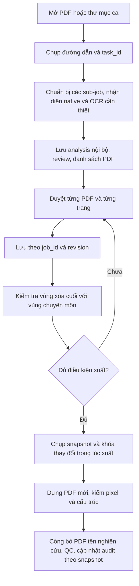

# Thiết kế sửa 15 vấn đề và tối ưu xử lý PDF

**Trạng thái:** Đề xuất để triển khai; lượt này chỉ lập kế hoạch, chưa sửa ứng dụng.
**Ngày:** 28/10/2026.
**Nguồn:** [Review 15 vấn đề](../../../../REVIEW_DU_AN_2026-10-28.md), [kết quả 14 test workflow](../../../../KET_QUA_14_TEST_WORKFLOW_2026-10-28.md).
**Yêu cầu người dùng:** Có checklist và kế hoạch xử lý từng vấn đề; tối ưu cả mở/duyệt, OCR, xử lý thư mục và sử dụng bộ nhớ. Người dùng giao quyền quyết định các lựa chọn kỹ thuật cho người lập kế hoạch.

## 1. Mục tiêu và giới hạn

- Giải quyết đủ F01–F15, giữ nguyên số thứ tự của báo cáo review.
- PDF đầu ra không sót PII trong các fixture đã đánh dấu và không mất nội dung chuyên môn ngoài vùng được người duyệt chấp nhận.
- Không tự ghi nhận con người đã duyệt. Batch chỉ chuẩn bị khi mở; xuất chính thức sau khi tất cả sub-job đã được duyệt.
- Mỗi request thay đổi trạng thái gắn với đúng job và revision; không dùng trạng thái của tab cũ để ghi vào ca mới.
- Sản phẩm bàn giao có tên theo mã nghiên cứu, không mang tên nguồn. Tên gốc, XML, ảnh xem trước, analysis và audit có PII chỉ ở vùng nội bộ.
- Tối ưu trên máy Windows offline hiện có, một người vận hành; có thể mở nhiều tab nhưng chỉ một tác vụ nặng chạy tại một thời điểm trong server.
- Giữ Python >=3.10, PyMuPDF 1.26.6, pypdf 6.10.0; ưu tiên stdlib, không thêm framework hoặc dependency để sửa các lỗi này.
- Giữ DPI OCR 200, xuất 200 mặc định và PNG không mất dữ liệu. Không giảm DPI/chất lượng/kiểm tra hash để lấy tốc độ.
- Không viết lại kiến trúc, không đổi OCR engine, không thêm GPU/cloud, database, hàng đợi phân tán hoặc cache dùng chung giữa bệnh nhân.
- Không sửa/xóa bệnh án nguồn. Không commit dữ liệu bệnh án, cache, log chứa PII hay môi trường `.venv`.

## 2. Phương án và lựa chọn đề xuất

| Phương án | Đánh đổi | Quyết định đề xuất |
|---|---|---|
| Sửa tại các hàm và endpoint hiện có, bổ sung test hồi quy; tối ưu dựa trên đo đạc | Ít thay đổi, dễ đối chiếu hành vi; vẫn cần quản lý rõ schema và snapshot | Chọn phương án này, phù hợp Ponytail và hệ thống một người dùng. |
| Viết lại thành dịch vụ xử lý nền, database và hàng đợi | Thêm nhiều thành phần vận hành, migration và dependency; chưa có nhu cầu nhiều người dùng | Không đưa vào đợt này. |
| Tăng luồng hoặc giảm DPI trước khi sửa logic | Có thể giảm thời gian ở vài mẫu nhưng tăng nguy cơ bỏ sót và RAM | Loại: không đáp ứng yêu cầu giữ độ đúng và chất lượng. |

## 3. Luồng đích

## 4. Quyết định giao diện dữ liệu

### Danh tính và đồng thời

- `review.json` bổ sung `schema_version=2`, `job_id` ngẫu nhiên bền vững và `revision` số nguyên. `study_id` vẫn là mã nghiên cứu, không dùng thay job ID.
- Mọi save, approve, switch sub-job và export phải mang `job_id`/`revision` của trạng thái đang xem; request cũ nhận HTTP 409, không ghi bất cứ thay đổi nào.
- Dùng khóa server cho chuỗi đọc–kiểm tra–ghi; không giữ khóa trong suốt OCR/render. Khi chạy tác vụ nặng, từ chối thao tác xung đột bằng 409 thay vì chạy đè nhau.
- Tác vụ nền giữ bản chụp đường dẫn job, revision và `task_id`. `/progress?task_id=...` không lấy mất kết quả khi một tab khác đọc; giữ kết quả cho đến tác vụ kế tiếp, không lưu lịch sử không giới hạn.
- `/download?job_id=...` và `/page/N?job_id=...` xác nhận job để tab cũ không nhận ảnh/sản phẩm của ca mới. Token/Host localhost tiếp tục được kiểm tra theo phạm vi endpoint.

### Duyệt và batch

- `export_case(job_root, draft=False, approve_all=False, progress_cb=None)` đổi mặc định thành không tự duyệt; CLI bỏ cơ chế luôn truyền `approve_all=True` trong `export-case`.
- UI có danh sách file với số trang đã duyệt/tổng; chuyển file phải lưu xong file cũ. Chỉ xuất cả ca khi toàn bộ file hợp lệ; bản thử vẫn DRAFT.
- Giữ nút duyệt tất cả nếu người dùng chủ động bấm; việc này không được gọi ngầm khi mở/xuất. Audit phản ánh thao tác duyệt toàn bộ, không suy diễn đã xem riêng từng trang.
- Tên đích batch: `<study_id>_F001_REDACTED.pdf` hoặc `<study_id>_F001_DRAFT.pdf`, thứ tự theo manifest bền vững. QC cùng basename. Không suy tên đích từ PII.
- Giữ quy tắc study ID `[A-Za-z0-9_-]{1,64}`. Với mã dài 64 ký tự, vẫn phải chuẩn bị được batch; tránh tạo study ID nội bộ vượt giới hạn chỉ vì thêm hậu tố file.

### Phân tích và vùng xóa

- Không bóc stream trước duyệt: giữ hàm `remove_isolated_watermarks(doc)` làm no-op tương thích trả `[]`. Watermark đúng mẫu thành proposal có `method` và `stream_xrefs`; chỉ xóa sau lựa chọn duyệt. Với stream độc lập, phải chứng minh mọi đối tượng vẽ chữ là watermark đã xác nhận, không có ảnh/nét vẽ/text chuyên môn và không làm thay đổi graphics state của nội dung khác. So cả text/geometry/style/ảnh/đồ họa trước–sau, không chỉ chuỗi text.
- Không phủ trắng bounding box lớn của watermark chéo: việc đó có thể xóa chữ nằm dưới. Nếu watermark nằm chung stream mà chưa tách được đúng toán tử vẽ, export phải báo vùng chưa xử lý an toàn; không có fallback âm thầm xóa cả hộp. Lựa chọn giữ/xử lý lại phải được ghi rõ và duyệt; không hứa tự khôi phục chữ đã bị raster watermark đè lên.
- `rotated_watermark_rects(page)` chỉ trả watermark đã xác nhận, không chọn mọi chữ xoay dài hơn sáu ký tự.
- Mở rộng mực chỉ tiếp tục khi có mực liên tiếp trong ngưỡng khoảng trắng 14 điểm ngay từ cạnh hộp; không vượt ranh giới trường đã xác định hoặc vùng bảo vệ.
- Ảnh ở cuối trang nhưng không có dấu hiệu chữ ký phải là `IMAGE_REVIEW`, mặc định chưa chọn. Giữ trường hợp chữ ký có anchor đủ rõ; không bảo đảm nhận diện mọi chữ ký.
- Trang có ảnh scan chứa nội dung chưa có text phải OCR, kể cả có header/số trang native. Giữ cả native và OCR; chỉ loại bản OCR trùng khi text chuẩn hóa giống và mức giao khung đủ lớn. Khi hai nguồn bất đồng, giữ để rà soát, không bỏ thông tin âm thầm.
- Lưu `analysis_private/<page>.json` với text, char map và `protected_rects`; đây là dữ liệu có PII, không đưa vào QC/bản bàn giao. Hash native và hash working PDF vẫn kiểm riêng.
- Tất cả vùng xóa sau mở rộng/khoanh tay/fallback ảnh đều kiểm giao hình học với ICD. Các trường tuổi/giới/kết quả nằm trong fixture chuyên môn phải được bảo toàn; không hứa bộ regex bảo vệ mọi câu chuyên môn.
- Trang xoay 90/180/270 độ hoặc cropbox khác mediabox phải ánh xạ đúng giữa native/OCR/canvas/export; có fixture khóa hành vi này.

### Audit và tương thích

- Audit được dựng từ snapshot review hiện tại và analysis nội bộ. Che text theo vùng hình học cuối cùng; vùng khoanh tay, bỏ chọn và vùng OCR đều tham gia.
- Gộp hợp các khoảng giao nhau; không bỏ đuôi của khoảng dài hơn.
- Audit là tài liệu nội bộ chứa PII nguyên văn ở bảng phát hiện; phần text sau che không phải chứng nhận rằng mọi pixel đã sạch.
- Job cũ không có schema/analysis: khi mở, thêm ID/revision trong thao tác có khóa. Nếu `watermarks_removed` khác rỗng, working có thể đã mất nội dung: phải tìm nguồn khớp `source_sha256` và chuẩn bị job mới từ nguồn; không tự suy analysis mới là đã phục hồi. Nếu không có nguồn đúng hash, cho xem nội bộ nhưng chặn xuất chính thức với trạng thái `SOURCE_RECHECK_REQUIRED`. Job không có dấu hiệu bóc stream có thể dựng analysis từ working sau kiểm hash; đánh dấu `NEEDS_VISUAL_REVIEW` khi hình học thay đổi.
- PDF và QC được công bố theo **thế hệ xuất bất biến**, không replace hai tệp đang công bố riêng lẻ: ghi toàn bộ cặp của file/ca vào staging cùng filesystem, verify, đổi tên thành `exports/<export_id>/`, rồi atomically replace `last_export.json` trỏ tới thế hệ đầy đủ. Download chỉ theo con trỏ đã công bố. Lỗi ghi QC/đổi tên/cập nhật pointer không thay thế thế hệ hợp lệ cũ; không báo count thành công bằng danh sách đường dẫn trùng. Không tự dọn thế hệ cũ trong đợt này.

## 5. Đo và nghiệm thu hiệu năng

Đo hai mốc: **B0** trước sửa, **B1** sau sửa độ đúng. Tối ưu so với B1 trên cùng tập dữ liệu/máy; không coi phần OCR bổ sung bắt buộc của PDF hỗn hợp là hồi quy cần bỏ đi.

Ghi thời gian đọc/hash, XML/seeds, text/geometry, OCR render, OCR engine, nhận diện, pixel scan, preview, lưu, export render/PNG và kiểm QC. Đo thời gian tới màn hình duyệt, median/p95 thời gian chuyển trang/lưu, trang/giây, RAM cực đại của Python cộng tiến trình OCR, dung lượng tạm/đầu ra và số lần gọi OCR/render/extract.

Mục tiêu đề xuất, cần baseline xác nhận khả thi: giảm >=25% thời gian prepare native; >=20% thời gian xử lý scan cả ca; >=50% p95 lưu/chuyển trang nếu đang bị full-save chi phối; >=25% RAM cực đại trên ca lớn. Không được có hồi quy >10% ở nhóm khác khi không thêm xử lý bắt buộc. Nếu không đạt mục tiêu, báo đúng phần giới hạn; không đổi tiêu chí chất lượng để đạt số.

Tập đo: native 10/150 trang; scan 10/50 trang; mixed 10 trang; ca 50 file × 2 trang; một tập nhiều vector/watermark và một tập file ảnh lớn. Dữ liệu thật chỉ chạy cục bộ khi có sẵn quyền truy cập; fixture tổng hợp không chứa PII thật.

## 6. Điều kiện hoàn tất

- F01–F15 đều có test/kiểm chứng tương ứng; không checkbox nào được đánh dấu xong chỉ vì đã sửa một hàm.
- 14 test workflow hiện tại tiếp tục đạt, trừ assertion khóa hành vi lỗi phải được sửa theo đặc tả mới, kèm giải thích. Ví dụ watermark có thể không còn bị bóc trước duyệt; assertion phải kiểm pixel sau xuất thay vì kỳ vọng stream bị xóa sớm.
- Test HTTP chạy đủ upload/open/save/switch/approve/export/download, token sai, stale revision và đọc progress từ hai tab.
- So sánh pixel trong/ngoài mask, lớp text/metadata/attachment/widget và hash nguồn; không suy ra sạch PII chỉ vì PDF không còn text.
- Báo benchmark ghi máy/phiên bản/corpus/lần chạy, cả kết quả tốt và chậm hơn. Không coi thời gian 3,749 giây của 14 unit test là baseline hồ sơ thật.
- Tài liệu, schema review, trạng thái QC và chính sách giữ/xóa thống nhất; giữ bằng chứng v1 ở mục lịch sử, không đổi nhãn thành kết quả v2.

## 7. Kế hoạch liên kết

- [Checklist và kế hoạch F01–F15](../plans/2026-10-28-fix-15-findings.md).
- [Kế hoạch đo và tối ưu hiệu năng](../plans/2026-10-28-pdf-performance.md).
